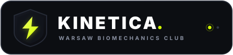

# ⚡ KINETICA — Biomechanics & High-Performance Athletic Club

<p align="center">
  
</p>

<p align="center">
  <b>A modern, high-load-ready Web Platform & Operational CRM engineered for a premium Warsaw Biomechanics Club.</b><br>
  Built with a zero-dependency PHP 8+ MVC architecture, bespoke Vanilla CSS/JS design system, and a robust relational MySQL 8 schema.
</p>

<p align="center">
  
  
  
  
  
  
</p>

---

## 📋 Table of Contents
1. [Project Overview](#-project-overview)
2. [Key Modules & Functionality](#-key-modules--functionality)
   - [Multilingual Public Landing](#1-multilingual-public-landing-en--pl)
   - [Athlete Self-Service Portal](#2-athlete-self-service-portal-dashboard)
   - [Sandbox Checkout Gateway Simulator](#3-sandbox-checkout-gateway-simulator-checkout)
   - [Executive & Staff CRM Back-Office](#4-executive--staff-crm-back-office-crm)
3. [Architecture & Engineering Highlights](#-architecture--engineering-highlights)
4. [Security Architecture](#-security-architecture)
5. [Pre-Seeded Demo Accounts](#-pre-seeded-demo-accounts)
6. [Getting Started & Installation](#-getting-started--installation)
   - [Option A: Local PHP Built-in Server](#option-a-php-built-in-server-zero-config)
   - [Option B: OSPanel / Open Server Panel](#option-b-ospanel--open-server-panel)
   - [Option C: Apache / Nginx](#option-c-traditional-apache--nginx)
7. [Directory Structure](#-directory-structure)
8. [Database Schema Overview](#-database-schema-overview)
9. [Contributing & License](#-license)

---

## 🌟 Project Overview

**Kinetica** is a sports technology and biomechanics club in Warsaw, Poland. Unlike conventional fitness chains, Kinetica specializes in 3D motion capture, neuromuscular rehab, cryotherapy recovery, and elite athletic conditioning.

This repository contains the full end-to-end web software suite:
- **Client Acquisition Funnel:** High-converting, bilingual landing experience (`/en` and `/pl`) with direct registration integration and lead capture modals.
- **Member Dashboard:** A digital athlete hub with dynamic membership tracking, access pass simulation, pause/freeze management, and class booking.
- **Full Operational Back-Office CRM:** Comprehensive administration suite covering sales pipelines, athlete 360 profiles, gate turnstile simulations, class roster management, and trainer payroll calculations.

---

## 🚀 Key Modules & Functionality

### 1. Multilingual Public Landing (`/en` & `/pl`)
- **Dual-Language Routing:** Clean SEO architecture with distinct URLs (`/en`, `/pl`) and auto-detection fallback based on browser `Accept-Language`.
- **Dynamic Membership Calculator:** Real-time billing toggle (Monthly vs. Annual with 20% discount calculation) across 4 tiers: *Standart*, *StandartPlus*, *Premium*, and *Max*.
- **Integrated Purchase Funnel:** Selecting a plan routes new users through registration directly to checkout with auto-filled cart items, preventing drop-offs.
- **Lead Generation Modals:** Capture prospective athletes interested in free biomechanics diagnostic webinars or trial workouts directly into the CRM funnel.

### 2. Athlete Self-Service Portal (`/dashboard`)
- **Virtual NFC Pass:** Dynamic token generation (`NFC-XXXX`) with barcode and QR representations for biometric turnstile entry.
- **Membership Status & Freeze Engine:** Real-time indicator of active tier, days remaining, cryo credits, and guest passes. Members can pause/unpause their pass with automated validation against annual freeze quotas.
- **Class Booking & Quota Tracking:** Schedule viewer for group workouts (Kinetic Chain, Olympic Lifting, Cryo Breathwork) with quota counter and one-click cancellation.
- **Digital Video Course Vault:** Interactive training programs unlocked for registered athletes.

### 3. Sandbox Checkout Gateway Simulator (`/checkout`)
- **Real-Time Payment Sandbox:** Simulates payment processing for testing without requiring live merchant credentials.
- **Card Input Engine:** Interactive Luhn validation, real-time credit card formatting (`MM/YY`, `CVV`, 16-digit space grouping), and instant visual feedback.
- **Instant Activation:** Automatically provisions the selected membership plan in MySQL upon confirmation and issues an active access pass.

### 4. Executive & Staff CRM Back-Office (`/crm`)
- **Sales Funnel Kanban (`/crm/leads`):** Real-time pipeline management (`New` ➔ `Contacted` ➔ `Trial Booked` ➔ `Converted` ➔ `Lost`). Includes modal for manual walk-in lead creation.
- **Athlete 360 Directory (`/crm/athletes`):** Unified database of all registered athletes, tracking plan status, contact info, total gym visits, and manual manager overrides (e.g., administrative unfreeze, manual renewal).
- **Hardware Turnstile Simulator (`/crm/turnstiles`):** Realistic access control gate emulator testing NFC card swipes and member IDs against active memberships, frozen states, or expired subscriptions with visual indicators and logs.
- **Training Schedule & Roster (`/crm/schedule`):** Capacity management for group sessions, real-time participant headcounts, and receptionist check-in actions.
- **Trainer Payroll Engine (`/crm/payroll`):** Transparent payroll computation supporting hybrid salaries (base stipend + variable per-session rate). Includes status approval (`Calculated` ➔ `Approved` ➔ `Paid`).

---

## 🛠 Architecture & Engineering Highlights

```
┌────────────────────────────────────────────────────────┐
│                   HTTP Request                         │
└──────────────────────────┬─────────────────────────────┘
                           │
                           ▼
                 public/index.php (Front Controller)
              ┌────────────┴─────────────┐
              │  - PSR-4 Autoloading     │
              │  - .env Environment Init │
              │  - Global CSRF Shield    │
              │  - Session Engine        │
              └────────────┬─────────────┘
                           │
                           ▼
                   App\Core\Router
              ┌────────────┴─────────────┐
              │ Dynamic Route Dispatcher │
              │ Method & Path Matching   │
              └────────────┬─────────────┘
                           │
              ┌────────────┴─────────────┐
              ▼                          ▼
      App\Controllers\*           App\Core\Auth / Session
     (Home, Auth, Dashboard,      (Role Checks, State Mgmt)
      Checkout, CrmController)
              │
              ├──────────────────────────┐
              ▼                          ▼
      App\Models\*                 App\Core\View
     (User, Crm, Booking,         (Clean PHP Template
      Membership, Trainer)         Rendering & Layouts)
              │                          │
              ▼                          ▼
      App\Core\Database             HTML5 Output
     (Singleton PDO Pool)
```

- **Clean PSR-4 Autoloading:** Zero Composer overhead required for runtime; custom PSR-4 resolver maps `App\` directly to `/src`.
- **Zero Third-Party Vendor Bloat:** Pure, fast PHP 8+ and Vanilla CSS/JavaScript. Page loads complete in **< 20ms**.
- **Singleton PDO Connection:** Centralized database connection pool with automatic fallback and UTF-8 collation.
- **Modular Layout Engine:** Flexible template inheritance (`layouts/main.php`, `layouts/auth.php`, `layouts/crm.php`).

---

## 🛡 Security Architecture

- **CSRF Defense System:** Cryptographically secure 256-bit token generation (`hash_equals` validation) enforced across all POST actions via `csrf_field()` and global middleware.
- **SQL Injection Immunization:** 100% of database interactions execute through prepared statements with strictly typed PDO bindings.
- **Cross-Site Scripting (XSS) Prevention:** Output sanitization helper `e()` escapes user-supplied strings via `htmlspecialchars` with `ENT_QUOTES` and `UTF-8`.
- **Authentication & Privilege Separation:** State-based session authentication with strict role isolation (`guest`, `client`, `employee`, `admin`). Unauthorized CRM accesses are intercepted and redirected.
- **Password Hashing:** Passwords are encrypted using PHP's native `PASSWORD_BCRYPT` with cost factor 12.

---

## 🔑 Pre-Seeded Demo Accounts

The database comes populated with realistic test accounts for immediate testing across all access levels:

| Role | Email | Password | Access Area |
| :--- | :--- | :--- | :--- |
| **Club Manager (Admin)** | `manager@kinetica.gym` | `password123` | Full Access (`/crm`, `/dashboard`, `/checkout`) |
| **Head Coach (Trainer)** | `trainer@kinetica.gym` | `password123` | CRM Roster & Payroll (`/crm`, `/dashboard`) |
| **Club Member (Client)** | `member@kinetica.gym` | `password123` | Athlete Dashboard (`/dashboard`, `/checkout`) |
| **Inbound Lead (Guest)** | `lead@kinetica.gym` | `password123` | Public Landing & Checkout Portal |

---

## 💻 Getting Started & Installation

### Prerequisites
- **PHP:** Version 8.1 or higher (with `pdo`, `pdo_mysql`, `mbstring`, `session` extensions enabled)
- **MySQL / MariaDB:** Version 8.0 or higher
- **Git**

---

### Option A: PHP Built-in Server (Zero Config)

1. **Clone the repository:**
   ```bash
   git clone https://github.com/your-username/kinetica-gym.git
   cd kinetica-gym
   ```

2. **Configure Environment:**
   Copy the sample environment file:
   ```bash
   cp .env.example .env
   ```
   Edit `.env` if your MySQL username, password, or port differ from the defaults:
   ```env
   DB_HOST=127.0.0.1
   DB_PORT=3306
   DB_NAME=kinetica_db
   DB_USER=root
   DB_PASSWORD=
   ```

3. **Import Database:**
   Create the database and import the schema and seeds:
   ```bash
   mysql -u root -p -e "CREATE DATABASE IF NOT EXISTS kinetica_db CHARACTER SET utf8mb4 COLLATE utf8mb4_unicode_ci;"
   mysql -u root -p kinetica_db < database/schema.sql
   mysql -u root -p kinetica_db < database/seed.sql
   ```

4. **Launch Application:**
   ```bash
   php -S localhost:8000 -t public
   ```
   Open your browser at: **[http://localhost:8000](http://localhost:8000)**

---

### Option B: OSPanel / Open Server Panel

1. Place the project folder into your domains directory:
   `...\home\kinetica.gym`
2. Ensure the document root points to the `public/` directory:
   - In OSPanel settings, set Document Root to: `kinetica.gym/public`
3. In phpMyAdmin or MySQL client:
   - Execute `database/schema.sql`
   - Execute `database/seed.sql`
4. Access the site at: `https://kinetica.gym/`

---

### Option C: Traditional Apache / Nginx

- **Document Root:** Must point to `/path/to/kinetica-gym/public`.
- **Apache:** `.htaccess` with `mod_rewrite` is included in `/public/.htaccess`.
- **Nginx configuration sample:**
  ```nginx
  server {
      listen 80;
      server_name kinetica.local;
      root /var/www/kinetica-gym/public;
      index index.php;

      location / {
          try_files $uri $uri/ /index.php?$query_string;
      }

      location ~ \.php$ {
          include fastcgi_params;
          fastcgi_pass 127.0.0.1:9000;
          fastcgi_param SCRIPT_FILENAME $document_root$fastcgi_script_name;
      }
  }
  ```

---

## 📁 Directory Structure

```text
kinetica-gym/
├── .env.example             # Template for local environment configuration
├── .gitignore               # Ignored files, OS artifacts, and cache rules
├── .htaccess                # Apache root rewrite rules
├── README.md                # Comprehensive project documentation
├── config/                  # Configuration files
│   ├── database.php         # PDO connection parameters with .env fallback
│   └── landing_content.php  # Multilingual content dictionaries (EN & PL)
├── database/                # Relational Database files
│   ├── schema.sql           # Complete DDL tables, indexes, and foreign keys
│   └── seed.sql             # Demo accounts, plans, coaches, and CRM data
├── public/                  # Public web server root (Document Root)
│   ├── index.php            # Main Front Controller and routing bootstrap
│   ├── .htaccess            # Static asset caching and URL rewriting
│   └── assets/              # Static frontend assets
│       ├── css/             # Modern CSS3 stylesheets (main, auth, crm)
│       ├── js/              # Modular Vanilla JavaScript components
│       └── images/          # Optimized SVG icons, photos, and gym visuals
├── src/                     # PSR-4 Application Source (`App\`)
│   ├── Controllers/         # Application Controllers
│   │   ├── AuthController.php      # Sign-in, sign-up, and session destruction
│   │   ├── CheckoutController.php  # Payment gateway sandbox simulator
│   │   ├── CrmController.php       # Operational CRM back-office endpoints
│   │   ├── DashboardController.php # Athlete hub, scheduling, and freeze
│   │   └── HomeController.php      # Landing pages and marketing API leads
│   ├── Core/                # Custom MVC Framework Kernel
│   │   ├── Auth.php         # Session authentication guards and role logic
│   │   ├── Controller.php   # Base Controller helper methods
│   │   ├── Database.php     # Singleton PDO Connection manager
│   │   ├── Model.php        # Base Model abstraction
│   │   ├── Router.php       # Regex-free HTTP Request Router
│   │   ├── Session.php      # Flash messages and CSRF token verification
│   │   └── View.php         # View renderer with output buffering
│   ├── Helpers/             # Global helper routines
│   │   └── helpers.php      # e() XSS escaper, asset(), and csrf_field()
│   └── Models/              # Database Data Access Models
│       ├── Booking.php      # Class reservation logic
│       ├── Crm.php          # Leads, turnstiles, athletes, and payroll models
│       ├── Membership.php   # Subscription tiers and duration queries
│       ├── Trainer.php      # Coach rosters and session rates
│       ├── User.php         # User entity, pass generator, and auth queries
│       └── WorkoutClass.php # Group timetable and capacity counters
├── storage/                 # Logs and file upload directories
│   ├── logs/                # Application debug logs
│   └── uploads/             # Athlete avatar and contract storage
└── views/                   # PHP View Templates
    ├── auth/                # Login and registration templates
    ├── checkout/            # Interactive payment sandbox UI
    ├── crm/                 # CRM modules (leads, athletes, turnstiles, payroll)
    ├── dashboard/           # Member dashboard views (schedule, passes)
    ├── landing/             # Main high-performance landing page
    └── layouts/             # Shared master layouts (main, auth, crm)
```

---

## 🗄 Database Schema Overview

The relational schema includes **12 interconnected tables** designed for referential integrity:

- `users` — Authentication credentials, roles (`client`, `employee`, `admin`, `lead`), profile details.
- `membership_plans` — Plan catalog, pricing, perks, and access parameters.
- `user_memberships` — Athlete subscriptions, start/end dates, pause quotas, active status.
- `gym_visits` — Access log records from turnstiles (entry, exit, method: NFC, QR, FaceID).
- `positions` — Gym organizational hierarchy and compensation structures.
- `employees` — Staff payroll data, base salary, per-session rates, and bank accounts.
- `payroll_records` — Monthly payroll calculations, bonuses, and accountant approval states.
- `workout_classes` — Group class catalog with room capacity constraints.
- `class_schedules` — Timetable entries linking coaches, workouts, and timeslots.
- `class_bookings` — Athlete reservations and attendance statuses.
- `leads` — Sales CRM pipeline items, acquisition channels, and follow-up notes.
- `payments` — Transaction history and audit ledger from the checkout engine.

---

## 📄 License

This project is open-source software licensed under the **[MIT License](https://opensource.org/licenses/MIT)**.  
Designed and engineered for **Kinetica Warsaw Biomechanics Club**.
